# API surface

Active contributors: utsmok

All HTTP endpoints live under `/api/v1` and are assembled in
`backend/src/journal_browser/main.py`. The surface splits into global routers
that exist once per deployment and an institution-scoped router mounted at
`/{code}` that serves every per-university resource. This page describes how
the surface is organized and the patterns it follows; the endpoint-by-endpoint
reference is [Endpoints](../../api/endpoints.md), and the app around it is
[Backend](index.md).

## Router organization

The global routers are mounted directly on `api_router`:

| Router | Prefix | File | Purpose |
|---|---|---|---|
| institutions | `/api/v1/institutions` | `backend/src/journal_browser/routers/institutions.py` | Directory of hosted institutions for the landing page |
| admin | `/api/v1/admin` | `backend/src/journal_browser/routers/admin/__init__.py` | Password-gated settings, deals, authors, feedback, docs, and run inspection |
| feedback | `/api/v1/feedback` | `backend/src/journal_browser/routers/feedback.py` | Anonymous `POST` intake from the in-app widget |
| docs | `/api/v1/docs` | `backend/src/journal_browser/routers/docs.py` | Markdown docs index and per-doc blocks with admin overrides |
| healthz | `/api/v1/healthz` | `backend/src/journal_browser/main.py` | `SELECT 1` plus the app version |

The scoped router uses `APIRouter(prefix="/{institution_code}")` and carries
the six resource routers: `journals`, `authors`, `publishers`, `orgunits`,
`deals`, and `meta`, each in its own module under
`backend/src/journal_browser/routers/`. A scoped handler declares
`InstitutionDep` from `backend/src/journal_browser/deps.py`, which resolves
the path code to an institutions row or raises 404 for an unknown code.

Registration order is part of the contract. `admin`, `feedback`, and `docs`
are included before the scoped router so their fixed prefixes are not
captured by the `/{institution_code}` catch-all (otherwise `/api/v1/admin/deals`
would parse as institution `admin`). `backend/tests/test_route_precedence.py`
pins this behavior. Inside `backend/src/journal_browser/routers/admin/__init__.py`
each submodule router carries its own `/admin` prefix, and the include order
matches the original monolithic `admin.py`.

```mermaid
graph TD
    API["api_router /api/v1"] --> INST["institutions"]
    API --> ADM["admin (auth, runs, settings,<br/>deals, feedback, docs, authors)"]
    API --> FB["feedback"]
    API --> DOC["docs"]
    API --> HZ["healthz"]
    API --> SCOPE["scoped_router /&#123;institution_code&#125;"]
    SCOPE --> J["journals"]
    SCOPE --> A["authors"]
    SCOPE --> P["publishers"]
    SCOPE --> O["orgunits"]
    SCOPE --> D["deals"]
    SCOPE --> M["meta"]
    SCOPE --> DEP["InstitutionDep: 404 unknown code"]
```

## Cursor pagination

List endpoints paginate with opaque cursors produced by
`backend/src/journal_browser/services/search/cursors.py`. `encode_cursor`
serializes `{"v": <sort value>, "k": <issn_l>}` to URL-safe base64;
`parse_cursor` decodes it and raises `ValueError` when the payload is
malformed, which the app-level handler turns into a 400. Responses carry
`next_cursor`, and clients pass it back verbatim as `cursor`. The routers
constrain the parameter shape with
`Query(max_length=512, pattern=r"^[A-Za-z0-9_-]*={0,2}$")`, so anything that
is not base64 fails FastAPI validation (422) before the service ever sees it.

## Error semantics

Error behavior is deliberately split across three layers:

1. **ValueError to 400.** `create_app()` registers an exception handler that
   maps any `ValueError` from routing or service code to
   `{"detail": str(exc)}` with status 400. Malformed cursors and bad
   domain-level input raised this way never leak as 500s.
2. **FastAPI boundary validation.** Parameter constraints declared with
   `Query(pattern=..., ge=..., le=..., max_length=...)` and pydantic models
   produce the standard 422 `RequestValidationError` response.
3. **Explicit HTTPException.** Routers raise 404 for unknown institutions,
   ignored or missing journals, and unknown doc slugs, and 413 for oversized
   feedback payloads (`MAX_PAGE_DATA_BYTES` is 1 MB in
   `backend/src/journal_browser/routers/feedback.py`).

## Concrete endpoint shapes

`backend/src/journal_browser/routers/journals.py` is the largest router and
shows the typical structure. Its endpoints:

- `GET /{code}/journals` builds `JournalSearchResponse`. Parameters: `q`,
  `search_in` (pattern `all|title|publisher|topic`), `deal`
  (`any|covered|not_covered`), `oa`, `doaj`, `quartile` (`Q1`-`Q4`),
  `topic`, `publisher`, `has_apc`, `has_works`, `oa_type`, `sort`,
  `dir`, `cursor`, `limit` (1 to 100, default 20), and `include_facets`.
  `oa_type` is a comma-separated multi-select converted by a `BeforeValidator`
  and validated against the `OaType` enum from `backend/src/journal_browser/vocab.py`.
  The handler delegates entirely to `search_service.search_journals` in
  `backend/src/journal_browser/services/search/` and reshapes rows through
  `_to_list_item`.
- `GET /{code}/journals/semantic-search` takes `q` (2 to 512 chars) plus
  `limit` and `cursor`, and delegates to `search_service.semantic_search`
  (pgvector, see [Search and discovery](../../systems/search.md)).
- `GET /{code}/journals/{issn_l}/similar` returns the similar-journals bundle
  from `search_service.similar_journals`, 404 for ignored or unknown ISSNs
  (the admin ignore-list is checked in `_is_ignored`).
- `GET /{code}/journals/{issn_l}/works` combines
  `work_sources.works_for_journal` with `detail_enrichment.list_works` into a
  `WorksPage`.
- `GET /{code}/journals/{issn_l}` assembles the detail response inline:
  effective deal coverage via the `deal_coverage` helpers
  (`deal_institution_join`, `dj_scope`), works stats with pure-canon primary
  and OpenAlex cross-check, and per-field `Attribution` entries whose caveat
  codes resolve against the limitations registry.

`backend/src/journal_browser/routers/meta.py` shows the institution-scoped
support endpoints. `GET /{code}/meta/limitations` lists the limitations
registry with an optional `source` filter and substitutes the institution's
`data_window_start` into `{window_start}` placeholders. `GET /{code}/meta/freshness`
returns this institution's `HarvestState` rows plus the shared global layer,
max-timestamp probes for six serving tables, and the degraded-source snapshot
from `backend/src/journal_browser/services/source_health.py`; the frontend
uses it for the footer and data-quality notes.

The admin routers follow the same delegate-to-a-service or direct-SQL pattern
behind HMAC bearer-token auth; their product behavior is covered in
[Admin panel](../../features/admin.md).

## OpenAPI pipeline

`backend/scripts/dump_openapi.py` imports the app (setting
`JB_SKIP_EMBEDDING_WARMUP=1` so no model loads) and writes the schema to the
repo-root `openapi.json` without a running server or database. The file is
committed, and `npm run generate` in `frontend/` turns it into
`frontend/lib/api-types.ts`. After any API change both files are refreshed
and committed together with the backend change; CI regenerates the schema and
fails if the committed file drifted. This is why every response model in
`backend/src/journal_browser/schemas.py` doubles as the TypeScript contract.

## Integration points

- **Frontend client**: `frontend/lib/api.ts` calls these endpoints through
  the generated types; see [Frontend](../frontend/index.md).
- **Institution scoping**: `InstitutionDep` and the `/{code}` prefix are the
  runtime side of [Multi-institution core](../../features/multi-institution.md).
- **Search services**: filter, facet, and cache-epoch semantics live behind
  the routers; see [Search and discovery](../../systems/search.md).
- **Settings**: admin endpoints read and write the overlay described in
  [Configuration](configuration.md).
