# Backend

Active contributors: utsmok

The backend is the FastAPI application in `backend/src/journal_browser/`. It
serves the entire `/api/v1` HTTP surface for every hosted institution, owns
the settings system the admin panel edits, and provides the packages the
harvest jobs import. It runs on Python 3.12 with SQLAlchemy 2 (async) against
Postgres 17 with pgvector, is managed with `uv`, and listens on port 8000 as
`journal_browser.main:app` (see the `CMD` in `backend/Dockerfile`). The
endpoint-by-endpoint reference lives in [API surface](api-surface.md); this
page is about how the application is put together.


## Directory layout

```text
backend/src/journal_browser/
├── main.py             # app factory, router wiring, ValueError→400, warmup
├── config.py           # Settings (pydantic-settings, JB_* env), YAML overlay
├── settings_schema.py  # FieldDef registry behind the admin settings API
├── db.py               # lazy async engine + sessionmaker, get_session
├── deps.py             # SessionDep and InstitutionDep dependencies
├── schemas.py          # every pydantic request/response model
├── vocab.py            # StrEnum vocabularies shared with DB and TypeScript
├── ingest.py           # IngestSession: harvest run bookkeeping
├── jobrunner.py        # run_job CLI wrapper for one-job scripts
├── docs.py             # markdown discovery and block parser for docs/
├── models/             # SQLAlchemy models (see Data model)
├── routers/            # HTTP surface, one module per resource + admin/
├── services/           # shared query/facet/cache/embedding logic
└── harvest/            # source adapters used by backend/jobs/
```

## Key abstractions

| Name | File path | One-line description |
|---|---|---|
| `create_app` | `backend/src/journal_browser/main.py` | Builds FastAPI: CORS, the `/api/v1` router tree, the ValueError handler, and the embedding warmup thread |
| `api_router` / `scoped_router` | `backend/src/journal_browser/main.py` | Global routers mounted first, then the `/{institution_code}` catch-all with the six resource routers |
| `Settings` | `backend/src/journal_browser/config.py` | pydantic-settings model over `JB_*` env vars, merged live with `settings.yaml` |
| `get_settings` | `backend/src/journal_browser/config.py` | Cached accessor that reloads when the YAML overlay's mtime changes |
| `get_session` | `backend/src/journal_browser/db.py` | Dependency yielding an `AsyncSession` from the lazily created engine |
| `InstitutionDep` | `backend/src/journal_browser/deps.py` | Resolves the `/{institution_code}` path scope; 404 for unknown codes |
| `IngestSession` | `backend/src/journal_browser/ingest.py` | Per-run bookkeeping: `harvest_runs` state, append-only `source_records`, landing files, manual overrides |
| `run_job` | `backend/src/journal_browser/jobrunner.py` | Parses `--limit`, opens one session, runs a job's async main |
| `SETTINGS_REGISTRY` | `backend/src/journal_browser/settings_schema.py` | One `FieldDef` per admin-editable knob, split into global and institution sections |
| `parse_blocks` | `backend/src/journal_browser/docs.py` | Dependency-free markdown splitter that turns a doc into renderable, overridable blocks |
| `OaType` and friends | `backend/src/journal_browser/vocab.py` | StrEnum vocabularies that DB CHECK constraints, pydantic models, and TypeScript unions all derive from |

## How it works

`main.py` is the composition root. `create_app()` attaches CORS from
`settings.cors_origins`, mounts the router tree, and registers one exception
handler: any `ValueError` raised inside a request becomes HTTP 400 with
`{"detail": ...}`. FastAPI's own `RequestValidationError` (422) keeps handling
parameters it validates at the boundary, such as `Query(pattern=...)` and
enum values. `create_app()` also starts a daemon thread that calls
`encode_query("warmup")` from `backend/src/journal_browser/services/embeddings.py`,
loading the ~130 MB ONNX encoder (`BAAI/bge-small-en-v1.5`) off the request
path; `JB_SKIP_EMBEDDING_WARMUP=1` skips it (offline schema dumps, CI).

Route order is load-bearing. `institutions`, `admin`, `feedback`, and `docs`
are mounted before the scoped router, because `/api/v1/{institution_code}`
would otherwise capture `/api/v1/admin/deals` as institution `admin`.
`backend/tests/test_route_precedence.py` pins this. The shared dependencies
come from `deps.py`: every handler takes `SessionDep`, and institution-scoped
handlers take `InstitutionDep`, which resolves the code to an `institutions`
row or raises 404.

```mermaid
graph TD
    UV["uvicorn journal_browser.main:app"] --> APP["create_app() FastAPI app"]
    APP --> APIR["api_router /api/v1"]
    APIR --> GLOB["institutions · admin · feedback · docs · healthz"]
    APIR --> SCOPE["scoped_router /&#123;institution_code&#125;"]
    SCOPE --> RES["journals · authors · publishers ·<br/>orgunits · deals · meta"]
    GLOB --> DEPS["deps.py: SessionDep / InstitutionDep"]
    RES --> DEPS
    DEPS --> DB["db.py: get_session"]
    GLOB --> SVC["services/ shared logic"]
    RES --> SVC
    SVC --> MODELS["models/ SQLAlchemy"]
    DB --> MODELS
    MODELS --> PG[("Postgres 17 + pgvector")]
    CFG["config.py get_settings()"] -.-> APP
    CFG -.-> DB
```



The layering rule is strict: routers call services, services call models,
and logic needed by more than one router moves into
`backend/src/journal_browser/services/` rather than being copied. Search,
facets, and cache-epoch invalidation all live there (see
[Search and discovery](../../systems/search.md)). Response and request shapes
sit in `backend/src/journal_browser/schemas.py`, one pydantic model class per
API object; `OaType` and the other enums in `vocab.py` are the single home
for every API vocabulary, so a new value lands there first and then in the
owning CHECK constraint.

The two supporting modules serve the pipeline rather than HTTP.
`backend/src/journal_browser/ingest.py` provides `IngestSession`, which each
harvest run uses to record `harvest_runs` state, store append-only
`source_records` versions (identical re-harvests insert nothing), keep raw
artifacts in the landing directory via `store_raw_file`, and re-apply curated
values through `apply_overrides` so re-ingestion never overwrites them. The
jobs themselves live in `backend/jobs/` (covered in
[Data pipeline](../../systems/data-pipeline/index.md)); `backend/src/journal_browser/jobrunner.py`
wraps a job's async main with `--limit` parsing and one engine/session pair.

`backend/src/journal_browser/docs.py` serves the repo's `docs/` markdown
through the API: it discovers files under `docs/data-pipeline/` and
`docs/pitch/`, and `parse_blocks` splits a document into typed blocks
(heading, paragraph, list, table, code, quote, hr) with stable `b000`-style
keys so the admin can override any single block in the `doc_edits` table
without touching source files. A missing docs directory degrades to an empty
index; docs are never a hard dependency.

## Configuration in brief

`backend/src/journal_browser/config.py` defines `Settings` over `JB_*`-prefixed
environment variables and merges the `backend/settings.yaml` admin overlay on
top, reloading live on mtime change. The full mechanism, the
`settings_schema.py` registry, and the feature-flag behavior have their own
page: [Configuration](configuration.md).

## Integration points

- **Frontend**: the Next.js app proxies `/api/*` to port 8000; its TypeScript
  client is generated from `openapi.json` (see
  [API surface](api-surface.md) for the drift-check pipeline).
- **Admin panel**: password-gated routers under `backend/src/journal_browser/routers/admin/`
  (auth, runs, settings_admin, deals_admin, feedback_admin, docs_admin,
  authors_admin); the product view is [Admin panel](../../features/admin.md).
- **Institution scoping**: every scoped handler resolves its institution via
  `InstitutionDep`; the design is described in
  [Multi-institution core](../../features/multi-institution.md).
- **Harvest jobs**: `backend/jobs/*.py` import `config`, `ingest`, `models`,
  and the adapters in `harvest/`; the same `get_settings()` overlay drives
  both serving and harvesting.
- **Docs volume**: `docs.py` reads the (mostly gitignored) `docs/` directory,
  honoring `JB_DOCS_DIR`.
- **Health**: `GET /api/v1/healthz` runs `SELECT 1` and reports `__version__`
  (`0.1.0` from `backend/src/journal_browser/__init__.py`); the compose
  healthcheck uses it.

## Entry points for modification

To add an endpoint, create or extend a router module in
`backend/src/journal_browser/routers/`, include it from `main.py` (globally
before the scoped router if its prefix must win), and put the response model
in `schemas.py`. To add a setting, declare the field on `Settings` in
`config.py`, add a `FieldDef` to `SETTINGS_REGISTRY` in `settings_schema.py`,
and document it in `backend/settings.yaml.example`. After any API change run
`backend/scripts/dump_openapi.py` and `npm run generate` so `openapi.json` and
`frontend/lib/api-types.ts` move together; conventions are collected in
[Patterns and conventions](../../how-to-contribute/patterns-and-conventions.md).

## Key source files

| File | Role |
|---|---|
| `backend/src/journal_browser/main.py` | App factory, router registration order, ValueError→400, embedding warmup |
| `backend/src/journal_browser/config.py` | `Settings`, YAML overlay merge, work-type exclusion policy |
| `backend/src/journal_browser/settings_schema.py` | Admin-editable settings registry with secret masking |
| `backend/src/journal_browser/db.py` | Lazy async engine and per-request sessions |
| `backend/src/journal_browser/deps.py` | `SessionDep` and the institution path scope |
| `backend/src/journal_browser/schemas.py` | All pydantic I/O models for the API |
| `backend/src/journal_browser/vocab.py` | Shared StrEnum vocabularies (OA types, deal sources, feedback, harvest status) |
| `backend/src/journal_browser/ingest.py` | `IngestSession` harvest bookkeeping and overrides |
| `backend/src/journal_browser/jobrunner.py` | CLI runner for individual jobs |
| `backend/src/journal_browser/docs.py` | Docs discovery and markdown block parsing |
| `backend/scripts/dump_openapi.py` | Offline OpenAPI dump to the repo-root `openapi.json` |
