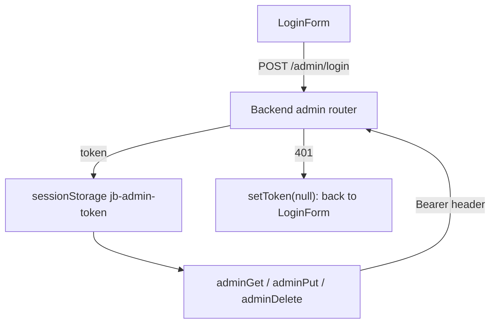

# Admin UI

Active contributors: utsmok

## Purpose

Two password-gated admin surfaces ship with the frontend: the global panel at
`frontend/app/admin/page.tsx`, which operates across all hosted institutions, and the
per-university panel at `frontend/app/[inst]/admin/page.tsx`, scoped to one institution. Both
cover harvest-run inspection and settings; the global panel adds feedback triage, deal curation,
and the flagged-deals queue. The docs pages also accept block-level edits under the same admin
token. What the panel does at the product level (settings system, curation policy) is described
in [Admin panel](../../features/admin.md); this page covers the frontend implementation.


## Directory layout

```text
frontend/
├── app/admin/page.tsx                  # global panel: runs, feedback, deals, settings
├── app/[inst]/admin/page.tsx           # per-university panel: runs, identity review, settings
├── components/admin/
│   ├── login-form.tsx                  # password form, calls adminLogin
│   ├── runs-table.tsx                  # RunsTable + StatusBadge
│   ├── feedback-table.tsx              # FeedbackSection (triage)
│   ├── deal-editor.tsx                 # DealsTable, DealEditor, CreateDealForm
│   ├── identities-table.tsx            # IdentitiesPanel (author identity review)
│   ├── work-identities-table.tsx       # WorkIdentitiesPanel (work identity review)
│   └── settings-forms.tsx              # schema-driven GlobalSettingsForm / InstitutionSettingsForm
├── hooks/use-admin-resource.ts         # shared admin list hook: GET + loading/error + refresh
└── lib/admin.ts                        # token storage, adminGet/Put/Post/Patch/Delete, payload types
```

## Key abstractions

| Abstraction | Where | Role |
|---|---|---|
| Admin token | `useAdminToken` in `frontend/lib/admin.ts` | Bearer token cached in `sessionStorage["jb-admin-token"]`, cleared on 401 |
| Admin fetch | `adminGet`/`adminPut`/`adminPost`/`adminPatch`/`adminDelete` | Same helpers with the Authorization header attached; `AdminError` carries the status |
| Admin resource | `useAdminResource` in `frontend/hooks/use-admin-resource.ts` | One shared hook for list loads: authenticated GET, loading/error state, manual refresh, 401 routes to sign-out |
| Settings schema | `SettingsResponse` in `frontend/lib/admin.ts` | Schema-driven form fields (string, number, bool, secret, list) from `GET /admin/settings` |
| Deal editor | `frontend/components/admin/deal-editor.tsx` | Editable deal detail: status, years, ESAC id, caps, journal membership |
| Runs table | `frontend/components/admin/runs-table.tsx` | Harvest-run rows with a status badge |

## How it works

### Authentication

`LoginForm` posts the password to `/api/v1/admin/login` and stores the returned token via
`useAdminToken`. Every admin request goes through `adminFetch` in `frontend/lib/admin.ts`, which
attaches the `Authorization: Bearer` header and maps non-OK responses to `AdminError`. Sections
react to a 401 by calling `onUnauthorized(setToken(null))`, which drops the token and renders the
login form again. The token lives in `sessionStorage`, so it disappears when the tab closes.



### Global panel

`frontend/app/admin/page.tsx` renders one section stack after the login gate:

1. Harvest runs: the newest 100 runs with an institution filter, via `RunsTable`. All three
   panel loads (runs, flagged deals, deals) go through `useAdminResource`; a change of
   institution filter just changes the hook's path and triggers the refetch.
2. Feedback triage: `FeedbackSection` lists reports with their captured page-data dumps.
3. Deals: a `DealsTable` plus `CreateDealForm` and `DealEditor`. The editor loads
   `GET /admin/deals/{id}`, edits status, start and end years, corresponding-authors-only,
   ESAC id, summary, and cap text (parsed into cap rows), and manages journal membership by
   ISSN lookup. A 409 surfaces as "ESAC id already in use". Any mutation calls the deals
   hook's `refresh` so the list refetches.
4. Flagged deals: rows from `GET /admin/flagged`; clicking one selects it in the editor above.
5. Institution settings: a university picker followed by `InstitutionSettingsForm`.
6. Global settings: `GlobalSettingsForm`.

Settings forms are schema driven. `GET /admin/settings` returns a field list plus current
values; secrets arrive masked, and an unchanged secret (or a cleared number field) omits itself
from the PUT body, so saving can never overwrite a secret with an empty value. Only changed
fields are sent. Field definitions ultimately come from the backend's
`settings_schema.py`, which is described in [Admin panel](../../features/admin.md).

### Per-university panel

`frontend/app/[inst]/admin/page.tsx` reads the institution code from context and shows four
sections, all fed through `useAdminResource` or the shared panels: that university's runs
(server-filtered), the author identity review panel (`IdentitiesPanel`), the work identity
review panel (`WorkIdentitiesPanel`), and its `InstitutionSettingsForm`. Review panels keep
row-level `busy` state so a double-click cannot send two flips, and replace the flipped row
from the server response.

### Docs editing

The docs viewer (`frontend/app/[inst]/docs/[slug]/page.tsx`) reuses the admin token for
block-level edits: `adminPut("/docs/{slug}/edits")` sends the replacement text plus an
`original_hash`, a SHA-256 of the text the editor saw (`sha256Hex` in `frontend/lib/docs.ts`),
so concurrent edits fail instead of clobbering. Auth failures bubble to the toolbar rather than
each block. The rendered markdown and `MermaidBlock` components live in
`frontend/components/docs/`.

## Integration points

- Backend admin routers (`admin/auth.py`, `runs.py`, `deals_admin.py`, `feedback_admin.py`,
  `settings_admin.py`, `docs_admin.py`) define every endpoint the panel calls; see
  [Backend](../backend/index.md).
- The settings overlay chain (`settings_schema.py` defaults, then the admin's `settings.yaml`)
  is a deployment concern covered in `DEPLOYMENT.md` and
  [Admin panel](../../features/admin.md).
- Types for all admin payloads derive from the generated contract in `frontend/lib/api-types.ts`
  (regeneration documented in [Tooling](../../how-to-contribute/tooling.md)).
- Harvest-run rows reflect the pipeline documented in
  [Data pipeline](../../systems/data-pipeline/index.md).

## Entry points for modification

- Add a settings field type: extend `SettingType` and the renderer in
  `frontend/components/admin/settings-forms.tsx`, then the backend schema.
- Add an admin section: load its data through `useAdminResource` (path, token, and the
  sign-out callback; the hook routes 401s and formats load errors), render through the
  shared table components, and keep row-level mutation state inside the section.
- Change deal-editing behavior: `frontend/components/admin/deal-editor.tsx` owns all deal field
  state and validation.
- Adjust auth handling: `frontend/lib/admin.ts` is the only place tokens are stored or attached.

## Key source files

| File | Contents |
|---|---|
| `frontend/app/admin/page.tsx` | Global panel: sections, shared-hook list loads |
| `frontend/app/[inst]/admin/page.tsx` | Per-university runs, identity review, settings |
| `frontend/hooks/use-admin-resource.ts` | Shared admin list hook |
| `frontend/lib/admin.ts` | Token hook, `AdminError`, typed fetch helpers, payload types |
| `frontend/components/admin/login-form.tsx` | Password sign-in |
| `frontend/components/admin/runs-table.tsx` | Harvest-run table |
| `frontend/components/admin/feedback-table.tsx` | Feedback triage section |
| `frontend/components/admin/deal-editor.tsx` | Deal table, editor, create form |
| `frontend/components/admin/identities-table.tsx` | Author identity review panel |
| `frontend/components/admin/work-identities-table.tsx` | Work identity review panel |
| `frontend/components/admin/settings-forms.tsx` | Schema-driven settings forms |
| `frontend/app/[inst]/docs/[slug]/page.tsx` | Docs viewer with hash-guarded block edits |
