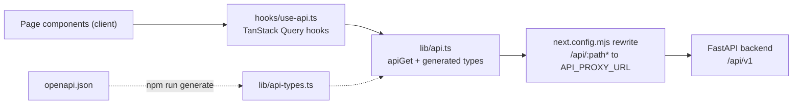

# Frontend

Active contributors: utsmok

## Purpose

The frontend is a Next.js 15 App Router application (React 19, TypeScript) that renders every
user-facing surface of Journal Browser: journal search, author and publisher browse, org-unit
pages, the deals register, the docs viewer, the about page, and the admin panel. One deployment
hosts all institutions under `/{code}` paths over a shared data core; the path segment scopes
navigation and every API call. Pages are client components that fetch through TanStack Query,
and the backend owns search, facets, and aggregation. Biome formats the code and ESLint lints
it; see `AGENTS.md` for the verify commands.


## Directory layout

```text
frontend/
├── app/
│   ├── layout.tsx            # root layout: fonts, metadata, theme pre-paint, Providers
│   ├── providers.tsx         # QueryClient + SiteMetaContext ("use client")
│   ├── page.tsx              # landing: institution chooser (or redirect when solo)
│   ├── globals.css           # Tailwind 4 + theme token block (light/dark)
│   ├── not-found.tsx
│   ├── admin/page.tsx        # global admin panel (all institutions)
│   └── [inst]/               # per-institution route tree
│       ├── layout.tsx        # wraps children in InstitutionProvider
│       ├── page.tsx          # journal search (home)
│       ├── journals/[issn_l]/  # journal detail (+ layout.tsx for <title>)
│       ├── author/           # author listing + author/[authorId] detail
│       ├── publisher/        # publisher listing + publisher/[...slug] detail
│       ├── orgunit/          # org-unit listing + orgunit/[...slug] detail
│       ├── deals/page.tsx    # open access deal register
│       ├── docs/             # docs index + docs/[slug] viewer
│       ├── about/page.tsx    # sources, limitations, attribution
│       └── admin/page.tsx    # per-university admin (runs + settings)
├── components/               # filter-panel, badges, search/, ui/, admin/, docs/, feedback/
├── hooks/                    # use-institution, use-api, use-site-meta
├── lib/                      # api.ts, api-types.ts (generated), admin.ts, docs.ts, format.ts, search-config.ts
├── scripts/                  # empty placeholder
├── next.config.mjs           # /api rewrite proxy
├── Dockerfile                # API_PROXY_URL + NEXT_PUBLIC_SITE_URL build args
└── biome.json, eslint.config.mjs, tsconfig.json
```

## Key abstractions

| Abstraction | File | Role |
|---|---|---|
| Root layout | `frontend/app/layout.tsx` | Server component: Inter/Montserrat fonts, metadata template, pre-paint theme script, header, footer, feedback widget, `Providers` |
| Query client | `frontend/app/providers.tsx` | TanStack Query defaults (60 s staleTime, one retry, `keepPreviousData`) plus the `SiteMetaContext` seeded from env |
| Institution context | `frontend/hooks/use-institution.tsx` | The `/{code}` segment as React context; empty string on global surfaces (landing, `/admin`) |
| Query hooks | `frontend/hooks/use-api.ts` | One hook per endpoint family, all keyed through the `qk` factory |
| API client | `frontend/lib/api.ts` | `apiGet` against same-origin `/api/v1`, param types, `errorMessage` status mapping |
| Generated types | `frontend/lib/api-types.ts` | `openapi-typescript` output of `openapi.json`; never hand-edited |
| Site meta | `frontend/hooks/use-site-meta.ts` | Institution display values with a three-tier fallback chain |
| Theming | `frontend/app/globals.css`, `frontend/components/theme-toggle.tsx` | CSS custom-property tokens, class-based dark variant, light/dark/system toggle |

## How it works

### Routing and shell

`frontend/app/page.tsx` fetches `/api/v1/institutions` on mount. With one institution it calls
`router.replace` straight to that site; otherwise it renders chooser cards. Every per-institution
page sits under `frontend/app/[inst]/layout.tsx`, which awaits the route params and wraps children
in `InstitutionProvider`, so any descendant reads the code with `useInstitution()`.

The root layout is a server component with `dynamic = "force-dynamic"` so a build-time prerender
cannot bake the image-build environment. It derives a `SITE_FALLBACK` object from the stack's
`JB_INSTITUTION_NAME`, `JB_INSTITUTION_SHORT`, `JB_LIBRARY_URL`, `JB_OA_GUIDE_URL`, `JB_SUPPORT_EMAIL`,
`JB_ADMIN_CONTACT`, and `JB_RESEARCH_PORTAL_URL` variables and passes it to `Providers`, so the
first server render already names the hosting institution instead of flashing a default.

`SiteNav` (`frontend/components/site-nav.tsx`) derives its link prefix from the first pathname
segment and renders nothing on global surfaces; `ThemeToggle` and the `FeedbackWidget` mount in
the root layout, outside the institution provider. `frontend/app/not-found.tsx` covers unknown
routes.

### Data layer

All reads go through `apiGet` in `frontend/lib/api.ts`: it serializes params (dropping empty
values), fetches `/api/v1${path}` with `cache: "no-store"`, and throws an `ApiError` carrying the
HTTP status. `errorMessage` maps the statuses the UI can hit (400/422, 404, 5xx) to human copy
while the technical detail stays in the console. Response types come from the generated
`frontend/lib/api-types.ts`; the regeneration pipeline is described in
[Tooling](../../how-to-contribute/tooling.md).

In development and in docker, `frontend/next.config.mjs` rewrites `/api/:path*` to
`API_PROXY_URL` (default `http://localhost:8000`). Next bakes rewrites into the build manifest,
so the Dockerfile declares `API_PROXY_URL` as a build `ARG` (compose default: the `backend`
service). `NEXT_PUBLIC_SITE_URL` is baked the same way and used for canonical citation links on
journal pages, which must point at the public hostname rather than the request origin.

Query cache keys are built by the `qk` factory in `frontend/hooks/use-api.ts`, and every key leads
with the institution code so two hosted universities never share cache entries. Journal search
adds a fetch-epoch guard that discards responses landing after the params moved on.

### Site meta resolution

`useSiteMeta()` resolves the display values (name, short name, library and OA-guide URLs, support
email, admin contact, research portal URL, data-window start) in three tiers: the scoped
`/{code}/meta/freshness` response once loaded, then the institutions directory row, then the env
seed. A nullable `admin_contact` stops falling through to the default university's value once the
authoritative data arrives. The footer renders outside the provider, so it falls back to the URL
segment where no provider exists.



### Theming

`frontend/app/globals.css` defines light and dark palettes as CSS custom properties with
shadcn-style names (`--background`, `--primary`, `--card`, and so on) and maps them into Tailwind
4 through `@theme inline`. The dark variant is class based (`@custom-variant dark`), and a small
inline script in `frontend/app/layout.tsx` applies the stored theme before first paint so reloads
never flash the wrong palette. `frontend/components/theme-toggle.tsx` cycles light, dark, and
system, persists to `localStorage["jb-theme"]`, and follows OS changes while in system mode. Two
details are deliberate: brand orange fails WCAG AA as text on white, so text uses the darker
`--primary-text` shade, and the dark palette is hand-rolled rather than pulled from a library.

### Docs viewer and about page

`frontend/app/[inst]/docs/page.tsx` lists the backend-served docs grouped into overview, pitch,
and sources (`frontend/lib/docs.ts` owns the ordering and fetch helpers); `docs/[slug]/page.tsx`
renders the parsed markdown blocks and supports block-level edits under the admin token (see
[Admin UI](admin-ui.md)). `frontend/app/[inst]/about/page.tsx` renders the source registry, the
limitations from `/meta/limitations` through `SourceNote`, and data attribution. The deals page
and search experience have their own page: [Search and browse UI](search-and-browse.md).

## Integration points

- Backend API: every fetch is same-origin and proxied; the endpoints are documented in
  [Backend](../backend/index.md) and [API surface](../backend/api-surface.md).
- Environment: `API_PROXY_URL` and `NEXT_PUBLIC_SITE_URL` are build args in
  `frontend/Dockerfile`; the `JB_*` display variables feed `SITE_FALLBACK` at runtime.
- Multi-institution: the `/{code}` contract that `use-institution.tsx` implements is specified in
  [Multi-institution core](../../features/multi-institution.md).
- Feedback: the widget mounted in the root layout is described in
  [Feedback](../../features/feedback.md); it snapshots the TanStack Query cache as page evidence.
- Admin: the panel pages and their auth live in [Admin UI](admin-ui.md), with the product-level
  description in [Admin panel](../../features/admin.md).
- Search behavior: the FTS, facets, and semantic ranking the UI drives are documented in
  [Search](../../systems/search.md).

## Entry points for modification

- Add a per-institution page: create the directory under `frontend/app/[inst]/` and a nav entry in
  `frontend/components/site-nav.tsx`.
- Consume a new endpoint: regenerate types (`cd frontend && npm run generate` after refreshing
  `openapi.json`), add a hook plus `qk` entry in `frontend/hooks/use-api.ts`, then fetch it from
  the page.
- Change default branding: edit `SITE_FALLBACK` in `frontend/app/layout.tsx`; deployment values
  stay in the stack's `JB_*` variables.
- Re-theme: replace the token block in `frontend/app/globals.css`; components only reference
  token names.
- Adjust search behavior: start at [Search and browse UI](search-and-browse.md).

## Key source files

| File | Contents |
|---|---|
| `frontend/app/layout.tsx` | Root shell, fonts, theme script, `SITE_FALLBACK` |
| `frontend/app/providers.tsx` | `QueryClient` defaults, `SiteMetaContext` |
| `frontend/app/page.tsx` | Landing chooser and solo redirect |
| `frontend/app/[inst]/layout.tsx` | `InstitutionProvider` wiring |
| `frontend/hooks/use-institution.tsx` | Institution path context |
| `frontend/hooks/use-api.ts` | All public query hooks, `qk` key factory, fetch-epoch guard |
| `frontend/hooks/use-site-meta.ts` | Site display-value fallback chain |
| `frontend/lib/api.ts` | `apiGet`, param and response types, `errorMessage` |
| `frontend/lib/api-types.ts` | Generated OpenAPI types (do not edit) |
| `frontend/lib/search-config.ts` | Sort options, sortable columns, search scopes |
| `frontend/lib/format.ts` | APC and euro formatting helpers |
| `frontend/lib/docs.ts` | Docs fetch, ordering, table parsing, `sha256Hex` |
| `frontend/lib/admin.ts` | Admin token storage and authenticated fetch helpers |
| `frontend/app/globals.css` | Theme tokens and Tailwind mapping |
| `frontend/next.config.mjs` | `/api` rewrite proxy |
| `frontend/Dockerfile` | Build args for proxy target and public site URL |
