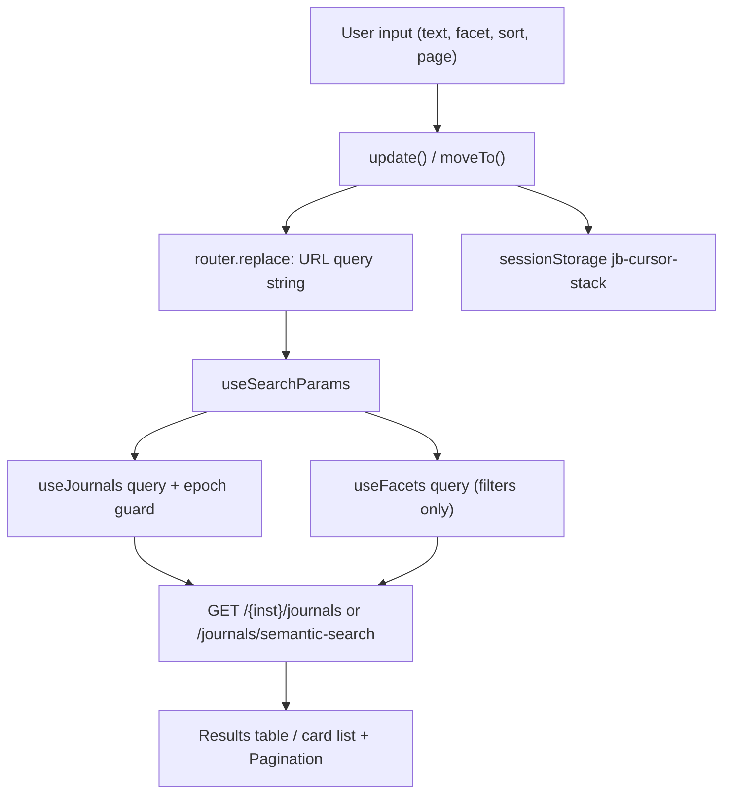

# Search and browse UI

Active contributors: utsmok

## Purpose

The search-and-browse surfaces are what researchers actually touch: the journal search home under
`/{code}`, the filter panel, the author, publisher, and org-unit listing pages, the deals
register, and the detail routes those lists link to (journal, author, publisher, org-unit). This
page covers how the UI holds state, how facets and cursor pagination behave, and the shared
display components (badges, OA charts, source notes) used across all of it. The app shell and
data-layer plumbing live in the [Frontend](index.md) page; backend search behavior lives in
[Search](../../systems/search.md).


## Directory layout

```text
frontend/
├── app/[inst]/
│   ├── page.tsx                     # journal search home (877 lines, client)
│   ├── journals/[issn_l]/           # journal detail (+ layout.tsx for <title>)
│   ├── author/page.tsx              # author listing
│   ├── author/[authorId]/page.tsx   # author profile (Pure UUID)
│   ├── publisher/page.tsx           # publisher listing
│   ├── publisher/[...slug]/page.tsx # publisher detail
│   ├── orgunit/page.tsx             # faculty/group listing
│   ├── orgunit/[...slug]/page.tsx   # org-unit detail
│   └── deals/page.tsx               # deal register
├── components/
│   ├── filter-panel.tsx             # FilterPanel + FacetGroupList (shared with listings)
│   ├── badges.tsx                   # lock-system SVG badges
│   ├── oa-composition.tsx           # OA-type bar + legend
│   ├── oa-trend.tsx                 # per-year stacked status chart
│   ├── source-note.tsx              # provenance + limitations tooltip
│   ├── orcid-link.tsx, back-link.tsx, collapsible-card.tsx, card-pager.tsx
│   ├── states.tsx                   # skeletons and error panels
│   └── search/pagination.tsx, search/sort-head.tsx
└── lib/search-config.ts             # sort keys, column sorts, search scopes
```

## Key abstractions

| Abstraction | Where | Role |
|---|---|---|
| URL-as-state | `frontend/app/[inst]/page.tsx` | Every search param (`q`, `deal`, `oa`, `sort`, `cursor`, `p`, `mode`) lives in the query string via `router.replace` |
| Filter panel | `frontend/components/filter-panel.tsx` | Builds facet groups from counts; two render variants, chips and rows |
| Facets query | `useFacets` in `frontend/hooks/use-api.ts` | Separate cache entry keyed on filters only |
| Fetch-epoch guard | `useFetchEpoch` in `frontend/hooks/use-api.ts` | Discards responses that land after the params changed |
| Cursor stack | `frontend/app/[inst]/page.tsx` | Session-stored list of visited keyset cursors powering Prev |
| Tri-state sort | `frontend/lib/search-config.ts`, `frontend/components/search/sort-head.tsx` | Column headers cycle natural, reversed, off |
| Access badges | `frontend/components/badges.tsx` | One SVG lock family whose shackle opens with access level |
| Source note | `frontend/components/source-note.tsx` | Hover/focus tooltip resolving caveat codes against the limitations registry |

## How it works

### Journal search page

`frontend/app/[inst]/page.tsx` reads all state from `useSearchParams()` and writes it back with
`router.replace(..., { scroll: false })` through one `update(patch)` helper. Any filter change
also drops the cursor and clears the stored stack synchronously, so an in-flight fetch can never
anchor a new result set to an older page. The text input debounces at 350 ms, `/` focuses the
field from anywhere, and Escape blurs it. With a query the default sort is `relevance`; for
browse-all it is `institution_works`, labeled with the institution short name. The whole view
sits inside a `Suspense` boundary because `useSearchParams` requires one during prerender.

Filters: `deal` (covered or not), booleans `oa`, `doaj`, `has_apc`, `has_works`, `quartile`,
`topic`, `publisher`, `search_in` scope (everything, title, publisher, topic), and `oa_type`,
the one multi-select, comma-joined in the URL and OR'd server-side. Single-select groups clear on
a second click; the `oa_type` group toggles membership.

Facet counts come from a separate query (`useFacets`) that strips `q`, `search_in`, `cursor`,
`sort`, and `limit` and re-runs the search with `include_facets: true, limit: 1`. Zero-hit
queries therefore still show which filter values exist to pivot to, and paging reuses the cached
aggregate. `FilterPanel` renders the top 8 values per group, keeping an active value visible even
when it falls outside the top 8, and picks a compact chip layout in a stacked card below 960 px
or a sticky sidebar above it. Facet options carry tooltips built from the institution name and
data window.

Pagination is keyset based. Next pushes `data.next_cursor` onto a stack mirrored in
`sessionStorage["jb-cursor-stack"]` so Prev survives a refresh in the same tab; the `p` param
(stack length + 1) gives the display page number. A stale or hand-edited cursor 400s forever, so
the error panel offers "Back to page 1" which clears cursor state.

Sort headers cycle natural, reversed, then off (back to the mode default) using
`COLUMN_SORTS` from `frontend/lib/search-config.ts`. Columns render through memoized TanStack
Table definitions whose closures read current sort state from a ref. Below the `md` breakpoint
the six-column table swaps to a stacked card list, because the decision columns would otherwise
need horizontal scrolling.

Semantic mode (`mode=semantic`, at least two characters) switches to
`/{inst}/journals/semantic-search`, which ranks by embedding similarity; filters and sorting do
not apply, so their UI hides and `SortHead` renders inert. A zero-hit exact search offers a
"Try match by meaning" button, and a `fuzzy` response flag shows a "showing close name matches"
notice.



### Listing pages

`frontend/app/[inst]/author/page.tsx`, `publisher/page.tsx`, and `orgunit/page.tsx` follow the
same conventions with their own param sets: URL state, debounced input, page-size selects (25,
50, 100), sort selects, and facets. They reuse `FacetGroupList` from
`frontend/components/filter-panel.tsx` with caller-built groups. The author listing joins its
multi-select facet values with `|` (works-count buckets, last-publication buckets), while journals
use commas; `frontend/lib/api.ts` defines the matching filter types. Publisher rows embed an
`OaCompositionBar` so the list itself shows each publisher's OA mix.

### Detail routes

`frontend/app/[inst]/journals/[issn_l]/page.tsx` composes the journal page from
`useJournal`, `useJournalWorks` (20 per page), and `useSimilar`. The similar-journals bundle has
three cuts (institution-publishing, deal-covered, general) and hides quietly on error; the works
section does the same. Collapsible cards hold deals, APC detail, and the citation block, which
builds a Harvard-style citation whose canonical URL uses `NEXT_PUBLIC_SITE_URL`. A
`CopyButton` writes the citation to the clipboard. `frontend/app/[inst]/journals/[issn_l]/layout.tsx`
adds `generateMetadata`, which fetches the journal title directly from the backend
(`API_PROXY_URL`, server side) for the document title and falls back silently.

Author profiles (`frontend/app/[inst]/author/[authorId]/page.tsx`) key on the Pure UUID. They
render a sticky section bar driven by an `IntersectionObserver` spy, OA trend and composition,
deal coverage per journal, and a "Back to search" link that restores the exact previous search
URL saved by the home page in `sessionStorage["jb-last-search"]`. `OrcidLink` renders ORCID iDs
with a link out. Publisher and org-unit details use catch-all `[...slug]` segments holding the
encoded name (`encodeNamePath` in `frontend/lib/api.ts`); both show aggregate cards (access mix,
quartile spread, APC range), deal rows with curated condition links (`frontend/lib/deal-links.ts`
orders and labels them), per-journal tables, and `OaTrend` charts. Org-unit pages add headline
unit stats (authors, works, deal-covered share, APC spend).

The deals page (`frontend/app/[inst]/deals/page.tsx`) fetches the current and archive lists in
parallel and renders one `CollapsibleCard` per deal, since scraped conditions, workflow, and
article-type prose runs long. Current and archive badges, cap tables, per-year OA counts, and a
"curation pending" badge (with its reason as tooltip) come from the deal payload.

### Shared display components

- `frontend/components/badges.tsx` replaces generic pills with a single SVG lock family:
  `OaTypeBadge` picks a lock state from closed (subscription) through wide (diamond), `DealBadge`
  and `QuartileBadge` complete the row lockups, and `OaStatusChip` orders work-level statuses.
  Colors are shared with the facet filters through `ACCESS_TEXT`.
- `frontend/components/oa-trend.tsx` stacks per-year OA statuses with `flexGrow` proportions, no
  chart library.
- `frontend/components/oa-composition.tsx` renders the OA-type distribution bar and legend.
- `frontend/components/source-note.tsx` resolves caveat codes against `/meta/limitations` and
  shows scope, severity, and hint on hover or focus; the about page reuses it.
- `frontend/components/states.tsx` provides `DetailSkeleton`, `ListSkeletonRows`, and
  `ErrorPanel` so loading and failure render consistently.

## Integration points

- Search endpoints: `/journals`, `/journals/semantic-search`, `include_facets`, cursor, and sort
  semantics are specified in [Search](../../systems/search.md).
- Similar journals and works sections depend on the embeddings and works stores described in
  [Backend](../backend/index.md).
- Limitations registry: `SourceNote` renders whatever `/meta/limitations` returns, so new caveats
  appear without frontend changes.
- Deal links: `frontend/lib/deal-links.ts` orders curated links so the first entry is the
  conditions document; the curation workflow is in [Admin UI](admin-ui.md) and
  [Admin panel](../../features/admin.md).
- Feedback: the widget rides along on all these pages, snapshotting the query cache; see
  [Feedback](../../features/feedback.md).

## Entry points for modification

- Add a facet group: extend `FilterPanel`'s `groups` array in
  `frontend/components/filter-panel.tsx` and the matching param in `JournalSearchParams`
  (`frontend/lib/api.ts`), then wire the toggle in `frontend/app/[inst]/page.tsx`.
- Add a results column: append a `ColumnDef` in the home page's `columns` memo and, if sortable,
  register it in `COLUMN_SORTS` in `frontend/lib/search-config.ts`.
- Add a detail section: follow the `CollapsibleCard` pattern in the journal page; add any new
  fetch as a hook in `frontend/hooks/use-api.ts` first.
- Change pagination behavior: both the stack logic (`frontend/app/[inst]/page.tsx`) and the
  controls (`frontend/components/search/pagination.tsx`) must stay in sync on the `p` formula.

## Key source files

| File | Contents |
|---|---|
| `frontend/app/[inst]/page.tsx` | Journal search: URL state, facets wiring, table, semantic mode |
| `frontend/components/filter-panel.tsx` | `FilterPanel`, `FacetGroupList`, top-8 logic |
| `frontend/lib/search-config.ts` | `SORTS`, `COLUMN_SORTS`, `SEARCH_IN_OPTIONS` |
| `frontend/components/search/pagination.tsx` | Prev/Next over the cursor stack |
| `frontend/components/search/sort-head.tsx` | Tri-state sort button |
| `frontend/app/[inst]/journals/[issn_l]/page.tsx` | Journal detail composition |
| `frontend/app/[inst]/author/[authorId]/page.tsx` | Author profile, section spy |
| `frontend/app/[inst]/publisher/[...slug]/page.tsx` | Publisher detail |
| `frontend/app/[inst]/orgunit/[...slug]/page.tsx` | Org-unit detail |
| `frontend/app/[inst]/deals/page.tsx` | Deal register cards |
| `frontend/components/badges.tsx` | Lock-family SVG badges, status colors |
| `frontend/components/oa-trend.tsx` | Per-year stacked OA chart |
| `frontend/components/source-note.tsx` | Limitations tooltip |
| `frontend/lib/format.ts` | APC/euro formatting, `apcStatsText` |
| `frontend/lib/deal-links.ts` | Deal link ordering and labels |
