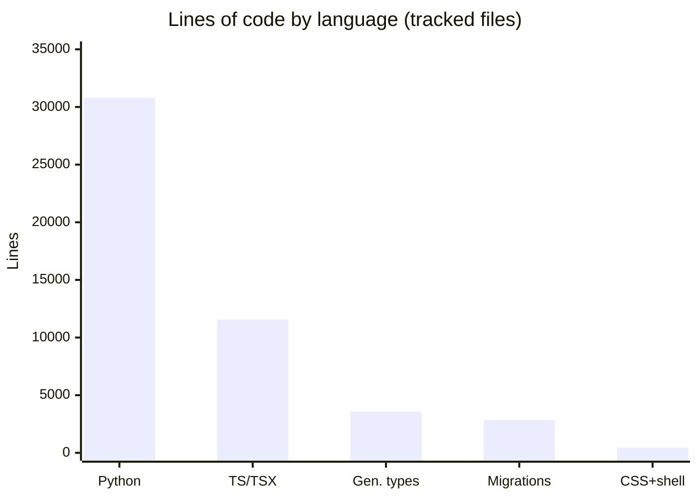
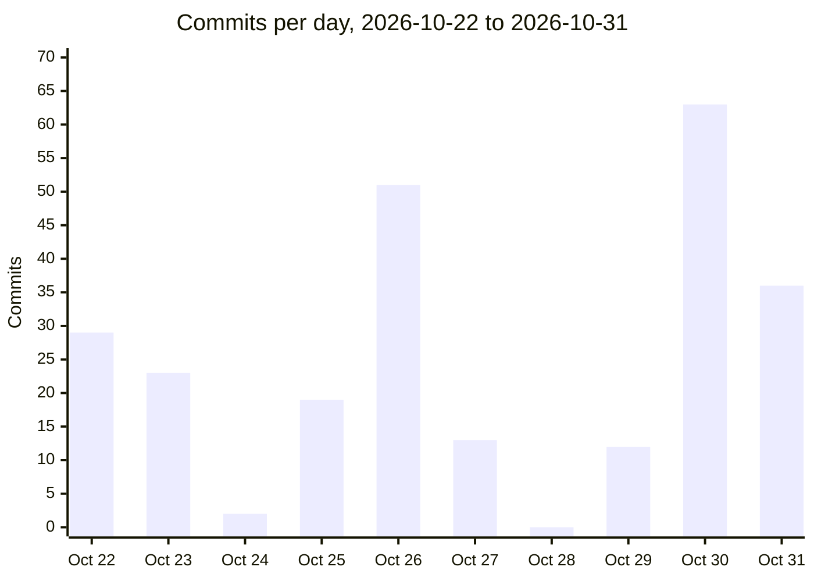

# By the numbers

Data collected on 2026-10-31.

The repository was created on 2026-10-22, so every figure below covers the
project's first ten calendar days, nine of which had commits. Counts come
from the tracked working tree (`git ls-files`) and the full commit history
(`git log`) as of 2026-10-31. Generated files are broken out separately
wherever they would distort a comparison.

At a glance: 329 tracked files, 248 commits, roughly 49,000 measured lines
of code, and zero bot-attributed commits.

## Size

Line counts come from `git ls-files '*.py' | xargs wc -l` (and the
equivalent for `*.ts` and `*.tsx`), split by path. Alembic migrations and
the generated API types are listed separately because neither is
hand-edited.

| Language and area | Files | Lines |
|---|---:|---:|
| Python — app package (`backend/src/journal_browser/`) | 99 | 18,253 |
| Python — job CLIs (`backend/jobs/`) | 29 | 2,664 |
| Python — tests (`backend/tests/`) | 47 | 9,691 |
| Python — scripts and dev tools (`backend/scripts/`, `backend/alembic/env.py`, `dev/`) | 3 | 188 |
| Python — Alembic migrations (`backend/alembic/versions/`, generated historical record) | 43 | 2,833 |
| TypeScript + TSX — frontend, excluding generated types | 63 | 11,558 |
| TypeScript — `frontend/lib/api-types.ts` (generated) | 1 | 3,585 |
| CSS (`frontend/app/globals.css`) | 1 | 370 |
| Shell (`docker-entrypoint.sh`, `validate_weak_rung.sh`) | 2 | 75 |

Measured code totals 49,217 lines, of which 6,418 (migrations plus
generated types) are not maintained by hand.

By file role, the 329 tracked files break down as:

| Role | Files |
|---|---:|
| Application source (Python, TypeScript, TSX, excluding tests) | 238 |
| Tests (all under `backend/tests/`) | 47 |
| Config and build (Dockerfiles, compose files, `pyproject.toml`, lint and format configs, CI workflow, shell tooling) | 24 |
| Styles (`globals.css`) | 1 |
| Docs and content (Markdown plus `LICENSE`) | 7 |
| Assets and seed data (6 screenshots, 3 Scimago `.csv.gz` seeds) | 9 |
| Generated and lockfiles (`openapi.json`, `package-lock.json`, `uv.lock`) | 3 |

The committed API schema `openapi.json` is 186,279 bytes (7,669 lines) per
`wc -c openapi.json` and `wc -l openapi.json` — the largest single file in
the repository. Regenerating `frontend/lib/api-types.ts` from it adds 3,585
lines, about 31 percent on top of the 11,558 handwritten frontend lines.

## Activity

Commits per day across the whole life of the repository, from
`git log --format='%ad' --date=short | sort | uniq -c`:

The pace is uneven: 2026-10-30 is the peak at 63 commits, about a quarter
of all 248, while 2026-10-28 is the only commit-free day. Across the nine
active days the average is about 28 commits per day.

Most-changed paths over the last 90 days — which is the whole life of the
repo — from `git log --name-only --format= | sort | uniq -c | sort -rn`.
Lockfiles never reach the top 20, so the narrative below just skips them;
`api-types.ts` appears because it is committed, though it is generated.

| Path | Touches |
|---|---:|
| `backend/src/journal_browser/services/search.py` | 36 |
| `backend/src/journal_browser/routers/journals.py` | 29 |
| `backend/src/journal_browser/schemas.py` | 28 |
| `backend/src/journal_browser/models.py` (since split into the `models/` package) | 28 |
| `frontend/lib/api-types.ts` (generated) | 26 |
| `frontend/lib/api.ts` | 22 |
| `backend/src/journal_browser/routers/admin.py` (since split into `routers/admin/`) | 21 |
| `backend/src/journal_browser/config.py` | 19 |
| `backend/tests/test_search_scopes.py` | 18 |
| `backend/src/journal_browser/harvest/reconcile.py` | 18 |

Aggregated to the directory level, the same history touches `backend/src/`
546 times, `backend/tests/` 217, `frontend/app/` 163, `backend/jobs/` 114,
`frontend/components/` 96, `frontend/lib/` 69, `backend/alembic/` 52, and
`frontend/hooks/` 22. A `docs/research/` directory (20 touches) and a
`docs/plan.md` (12) saw steady early work but are gone from the tree today.

## Bot-attributed commits

Zero, and that is a measurement, not an inference. `git log --format='%an
%b' | grep -ci 'co-authored-by'` returns 0, no commit carries a
`Co-authored-by` trailer, and no commit is attributed to a bot-pattern
account (Dependabot, Renovate, GitHub Actions). The repo does carry a
`.github/dependabot.yml`, but Dependabot has not opened anything yet. All
248 commits are attributed to human identities.

The usual caveat applies: trailers are only the conventional marker for
assisted work. A count of zero here is a lower bound on AI-assisted
commits, not evidence that none happened.

## Complexity

Average and total file size per top directory (`git ls-files <dir> | xargs
wc -l`, Python on the backend, TS/TSX on the frontend, generated types
excluded):

| Directory | Files | Lines | Avg lines/file |
|---|---:|---:|---:|
| `backend/src/journal_browser/harvest/` | 36 | 9,059 | 252 |
| `backend/src/journal_browser/services/` | 22 | 3,827 | 174 |
| `backend/src/journal_browser/routers/` | 18 | 2,136 | 119 |
| `backend/src/journal_browser/models/` | 12 | 1,357 | 113 |
| `backend/src/journal_browser/` root modules | 11 | 1,874 | 170 |
| `backend/jobs/` | 29 | 2,664 | 92 |
| `backend/tests/` | 47 | 9,691 | 206 |
| `frontend/app/` | 23 | 6,719 | 292 |
| `frontend/components/` | 30 | 3,865 | 129 |
| `frontend/lib/` | 7 | 677 | 97 |
| `frontend/hooks/` | 3 | 297 | 99 |

Harvest adapters dominate the backend: `harvest/` holds just under half of
the app package's 18,253 lines, and the two author-ingest adapters
(`author_ids.py` at 865 lines, `authors.py` at 787) are the largest backend
files. On the frontend, the pages carry the weight — `frontend/app/`
averages 292 lines per file, inflated by the two files that top the
largest-file list.

Largest source files, from `git ls-files '*.py' '*.ts' '*.tsx' | xargs wc
-l | sort -rn`, excluding generated `api-types.ts` (lockfiles are not in
these extensions):

| File | Lines |
|---|---:|
| `frontend/app/[inst]/journals/[issn_l]/page.tsx` | 1,067 |
| `frontend/app/[inst]/page.tsx` | 876 |
| `backend/src/journal_browser/harvest/author_ids.py` | 865 |
| `backend/src/journal_browser/harvest/authors.py` | 787 |
| `frontend/components/admin/deal-editor.tsx` | 716 |
| `backend/src/journal_browser/schemas.py` | 685 |
| `backend/tests/test_search_scopes.py` (test) | 630 |
| `frontend/app/[inst]/publisher/page.tsx` | 629 |
| `frontend/app/[inst]/orgunit/page.tsx` | 616 |
| `backend/tests/test_publishers.py` (test) | 608 |

Two of the ten largest source files are tests, which is consistent with the
test-to-code ratio: `backend/tests/` holds 9,691 lines against 20,917 lines
of backend application code (`backend/src/` plus `backend/jobs/`), about 46
percent, or one test line per 2.2 application lines. The frontend has no
test files at all — the only non-backend match for the test-file pattern is
`compose.test.yml`, which is a compose file, not a test.

The API surface is compact. `grep -rc '@router'
backend/src/journal_browser/routers --include='*.py'` sums to 41 route
handlers across 16 router modules:

| Router module | Handlers |
|---|---:|
| `admin/deals_admin.py` | 6 |
| `journals.py` | 5 |
| `orgunits.py` | 4 |
| `admin/settings_admin.py` | 4 |
| `admin/feedback_admin.py` | 3 |
| `publishers.py`, `meta.py`, `docs.py`, `deals.py`, `authors.py` | 2 each |
| `admin/runs.py`, `admin/docs_admin.py`, `admin/authors_admin.py` | 2 each |
| `institutions.py`, `feedback.py`, `admin/auth.py` | 1 each |

The 42nd operation, the health check, is registered as `@api_router.get`
in `main.py` rather than in the routers package, which is why the committed
`openapi.json` shows 36 paths and 42 operations. Database schema changes
are tracked by 43 Alembic migrations totalling 2,833 lines — about 66 lines
per migration on average, plus a 56-line `env.py`. Per `AGENTS.md`, the
versions directory is exempt from formatting, so those line counts include
historical style.
