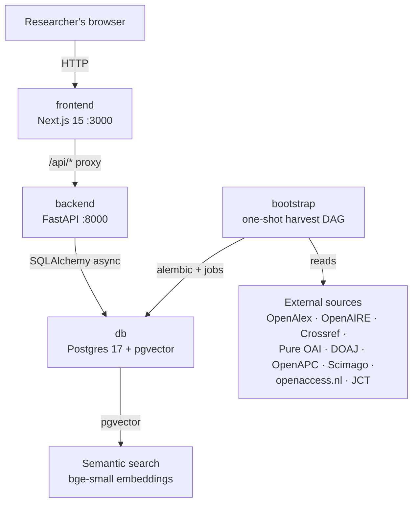

# Architecture

Open Journal Browser is two apps plus a database: a FastAPI backend that serves
the API, a Next.js frontend that renders the UI, and a Postgres 17 database
with pgvector. A one-shot `bootstrap` container fills the database by
running the harvest pipeline before the backend starts. All containers are
defined in `docker-compose.yml`.

## Runtime topology

Port bindings in `docker-compose.yml` are deliberate: only the frontend is
published on `0.0.0.0:3000` (it goes through the host's reverse proxy); the
database and backend stay loopback-only (`127.0.0.1:5433`, `127.0.0.1:8000`).
The backend container waits for `bootstrap` to complete successfully, so a
half-filled database is never served.

## Backend layering

The backend code in `backend/src/journal_browser/` follows a strict
layering. Routers never share query logic with each other; anything used by
more than one router lives in `services/`.

```mermaid
graph TD
    subgraph API["routers/ — HTTP surface"]
        G["Global: institutions, admin,<br/>feedback, docs, healthz"]
        S["Scoped: /&#123;code&#125;/ journals,<br/>authors, publishers, orgunits,<br/>deals, meta"]
    end
    subgraph SVC["services/ — shared logic"]
        SEARCH["search/ · facets · cache"]
        DOM["authors · publishers ·<br/>orgunits · embeddings ·<br/>detail_enrichment · deal_coverage"]
    end
    M["models/ — SQLAlchemy 2 async models"]
    P[("Postgres 17 + pgvector")]

    G --> SVC
    S --> SVC
    SVC --> M
    API_GLOW["schemas.py — pydantic I/O"] -.-> G
    API_GLOW -.-> S
    SVC --> P
    M --> P
```

Route registration order in `backend/src/journal_browser/main.py` matters:
`admin`, `feedback`, and `docs` are mounted before the
`/{institution_code}` scoped router so their fixed paths are not captured by
the institution catch-all. `backend/tests/test_route_precedence.py` pins
this behavior.

## Harvest pipeline

The `bootstrap` service runs `backend/jobs/bootstrap.py`, which executes the
jobs in `backend/jobs/` as a dependency DAG in two layers:

1. **Global layer** (institution-neutral, runs once): the OpenAlex
   journal-universe sweep (~177k sources into ISSN-L-keyed journals), the
   deal register (openaccess.nl scrape + JCT ingest + reconcile + ISSN-L
   backfill), OpenAPC, Scimago, DOAJ canon, OA-color sampling, and journal
   embeddings.
2. **Per-institution layer** (runs for each hosted code): Pure OAI-PMH
   works, CERIF entities, work enrichment (OpenAlex → Crossref), OpenAIRE
   DOI confirmations, institution statistics, reconcile, the local
   `openalex_works` store, the author-id cascade, and author ingest.

Jobs are idempotent. A failure stops new launches and names its step; the
backend stays down until the pipeline succeeds. The full DAG, source-by-
source, is documented in [Data pipeline](../systems/data-pipeline/index.md).

## Data organization

The schema splits into a shared core and per-institution data:

- **Shared once**: `journals` (ISSN-L-keyed), `issn_map`, `deals` +
  `deal_journals` + `deal_institutions`, `journal_apc_aggregates`,
  `scimagojr_metrics`, `journals.embedding` (384-dim pgvector).
- **Per institution**: `works` (keyed `(institution_id, pure_uuid)`),
  `institution_works_stats`, `journal_flags`, `authors`/`author_works`,
  `author_identities`, `openalex_works`, `pure_orgs`/`pure_persons`.
- **Cross-cutting**: `harvest_runs` (job bookkeeping), `feedback_items`,
  `source_records` (verbatim raw responses), `limitations` (caveats cited on
  detail pages).

Journal-level `oa_type` is derived at query time in
`backend/src/journal_browser/services/` rather than stored; work-level
`oa_status` is stored as published and never derived. See
[Search and discovery](../systems/search.md) and
[Data model](../systems/data-model.md).

## Optional accelerator

A second Postgres, the standalone ut-metadata platform, can act as a
read-only accelerator behind `JB_UT_METADATA_DSN` with
`author_source=utmd`. The default is `author_source=local`, under which
nothing reads that DSN and everything derives from the Pure CERIF entities
and the OpenAlex works store. See [Data pipeline](../systems/data-pipeline/index.md).

## Language breakdown

The codebase is roughly half Python (backend app, harvest jobs, tests) and
half TypeScript (frontend). Ruff and ty govern the Python; Biome and ESLint
govern the TypeScript. Counts are on the [By the numbers](../by-the-numbers.md) page.
