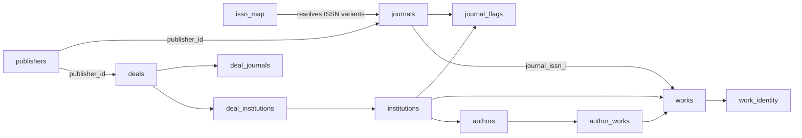

# Data model

Active contributors: utsmok

The serving database is a single Postgres 17 instance (with pgvector) that
hosts every institution on one shared journal and deal core. This page
explains the schema as modeled in `backend/src/journal_browser/models/`:
where the shared core ends and per-institution data begins, why search
state is denormalized onto the journal row, and how identity and curation
state survive re-harvesting. The harvest jobs that fill these tables are
covered in [Data pipeline](data-pipeline/index.md); the query-time reading
of the denormalized columns is covered in [Search](search.md).

## Purpose

One deployment serves several institutions at `/{code}` paths over the same
data, so the schema splits by write ownership: a global layer harvested
once, and a per-institution layer harvested per hosted code. The schema is
defined entirely by SQLAlchemy 2 declarative models; Alembic migrations in
`backend/alembic/` evolve it, and normalized tables are rebuildable from
the landing store so the pipeline can be replayed.

## Directory layout

- `backend/src/journal_browser/models/` - one module per domain:
  - `backend/src/journal_browser/models/journals.py` - journals, Scimago metrics, per-institution journal flags
  - `backend/src/journal_browser/models/deals.py` - deals, deal journal coverage, deal partnerships
  - `backend/src/journal_browser/models/works.py` - canonical works and cross-source identity links
  - `backend/src/journal_browser/models/authors.py` - author roster and author-work edges
  - `backend/src/journal_browser/models/pure.py` - Pure CERIF entities (org tree, persons, work authorship)
  - `backend/src/journal_browser/models/openalex.py` - OpenAlex works store and author identity review rows
  - `backend/src/journal_browser/models/evidence.py` - APC evidence and institution statistics
  - `backend/src/journal_browser/models/harvest.py` - run bookkeeping and the landing store
  - `backend/src/journal_browser/models/app_data.py` - cache epoch, overrides, feedback, limitations, doc edits
  - `backend/src/journal_browser/models/reference.py` - institutions, ISSN map, publishers
  - `backend/src/journal_browser/models/base.py` - declarative base and the shared timestamp helper
  - `backend/src/journal_browser/models/__init__.py` - the model registry every import goes through
- `backend/alembic/versions/` - migrations (historical record, never reformatted)

## Key abstractions

| Module | Model | Table | Role |
|---|---|---|---|
| reference | `Institution` | `institutions` | The shared-core boundary; hosted rows carry `code` + `active` |
| reference | `IssnMap` | `issn_map` | ISSN to ISSN-L resolution index |
| reference | `Publisher` / `OpenalexPublisher` | `publishers` / `openalex_publishers` | Publisher records and the OpenAlex lineage cache |
| journals | `Journal` | `journals` | The ISSN-L-keyed journal universe plus denormalized global search columns |
| journals | `JournalFlags` | `journal_flags` | Per-institution denormalized state for search and facets |
| journals | `ScimagojrMetric` | `scimagojr_metrics` | SJR and quartile per ISSN-L and year, stored as published |
| deals | `Deal` | `deals` | Deal register rows with `needs_curation` state |
| deals | `DealJournal` | `deal_journals` | Coverage lists; shared rows and institution-scoped overrides |
| deals | `DealInstitution` | `deal_institutions` | Deal partnership relation; a missing row means non-participation |
| works | `Work` | `works` | Canonical Pure work per institution, keyed `(institution_id, pure_uuid)` |
| works | `WorkIdentity` | `work_identity` | Confirmed and candidate external identity links per work |
| authors | `Author` | `authors` | Per-institution researcher, full-replaced at ingest |
| authors | `AuthorWork` | `author_works` | Author-work membership edges, full-replaced per institution |
| pure | `PureOrg`, `PureOrgParent`, `PurePerson`, `PurePersonOrg`, `WorkPureAuthor` | `pure_*`, `work_pure_authors` | The standalone CERIF canon behind the author path |
| openalex | `OpenalexWork` | `openalex_works` | Normalized institution-scoped OpenAlex works store |
| openalex | `AuthorIdentity` | `author_identities` | Durable identity review decisions that survive author re-ingest |
| evidence | `ApcEvidence`, `JournalApcAggregate` | `apc_evidence`, `journal_apc_aggregates` | Per-article OpenAPC rows and journal-level period aggregates |
| evidence | `InstitutionWorksStats`, `InstitutionTrend` | `institution_works_stats`, `institution_trends` | Precomputed per-journal and institution-wide year statistics |
| harvest | `HarvestRun`, `HarvestState` | `harvest_runs`, `harvest_state` | Job run history and latest status per job key |
| harvest | `SourceRecord`, `RawFile` | `source_records`, `raw_files` | The append-only landing store (payload and file level) |
| app_data | `CacheEpoch` | `cache_epoch` | One-row invalidation counter for in-process caches |
| app_data | `ManualOverride`, `Feedback`, `Limitation`, `DocEdit` | `manual_overrides`, `feedback_items`, `limitations`, `doc_edits` | Curated and application-owned state |

## Core relationships

Harvest bookkeeping sits beside these: `works.first_seen_run` and
`works.last_seen_run` reference `harvest_runs`, and `source_records` rows
version every verbatim payload per `harvest_run_id`.

## How it works

### Shared core and per-institution data

The global layer is institution-neutral and harvested once: `journals`,
`scimagojr_metrics`, `issn_map`, `publishers`, `openalex_publishers`,
`deals`, the shared `deal_journals` rows, `journal_apc_aggregates`, and the
journal-level `journals.embedding` vector.

The per-institution layer always carries an `institution_id` foreign key
and is harvested per hosted code: `works`, `journal_flags`, `authors`,
`author_works`, `openalex_works`, `author_identities`, the `pure_*` CERIF
tables, `work_pure_authors`, `institution_works_stats`, and
`institution_trends`.

`institutions` is the boundary between the two. Every row is a real-world
institution (the JCT sheets populate participation rows that have no code);
only hosted institutions carry `code` and `active=true`. The row also
carries the institution's harvest configuration (`pure_oai_base_url`,
`openaire_org_id`, an optional read-only `external_works_dsn`) and its
publication-year data window, which bounds every per-institution statistic.

### ISSN-L keying

`journals.issn_l` is the primary key (`String(9)`): the harvest normalizes
OpenAlex sources to the linking ISSN so a journal's print and electronic
variants collapse into one row. `issn_map` (`issn` to `issn_l`, harvested
from the same OpenAlex sources) is the resolution index used elsewhere:

- Deal lists publish bare print or online ISSNs, so `deal_journals.issn`
  stores the published value and gains `issn_l` after the ISSN-L backfill
  sweep. Rows that never resolve are flagged `needs_curation`.
- Search-time ISSN queries normalize the input (hyphens, spaces, case) and
  match both `journals.issn_l` directly and through `issn_map`, so any
  variant finds the journal.

### Denormalized search state

Search must stay a simple indexed join, so aggregation results are
materialized onto the rows that read them instead of computed per request.

Global columns on `journals` (refreshed by
`backend/src/journal_browser/harvest/denorm.py` and the matching harvest
jobs):

- `latest_quartile` and `in_scimago` from the Scimago ingest.
- `latest_apc_euro`: the highest single reported OpenAPC cost in the
  journal's newest period with cost evidence, so result tables sort on APC
  without a correlated subquery per row.
- `oa_status_observed`: the modal non-green work-level `oa_status` across
  the journal's most recent works (sampled by
  `backend/src/journal_browser/harvest/journal_oa.py`). Bronze, closed, and
  green observations mean "no OA color observed" and never classify.
- `doaj_*` canon fields from the DOAJ harvest
  (`backend/src/journal_browser/harvest/doaj.py`): `doaj_in_doaj` is
  tri-state until a full sweep stamps non-matches, and `doaj_has_apc` is
  the venue's own charge declaration (true is gold evidence, false is
  diamond).
- `search_text` plus the generated `search_vector` TSVECTOR column that
  drives full-text search.
- `embedding`, a 384-dim pgvector column written only by
  `backend/jobs/embed_journals.py`.

Per-institution state lives in `journal_flags`, fully materialized as one
row per journal per hosted institution: `works_count` (the institution's
works in the journal), `deal_covered` (override-aware effective coverage),
`works_window_plus` (the journal's works inside this institution's data
window), and `browse_excluded` (proceedings-like titles with no deal and no
institution works). Refreshes run as single idempotent statements guarded
with `IS DISTINCT FROM` so unchanged rows are not rewritten, and each
refresh bumps the cache epoch (see [Search](search.md)).

Journal-level `oa_type` is deliberately not stored anywhere; it is derived
at query time (see [Search](search.md)).

### Works and identity confirmations

`works` is keyed `(institution_id, pure_uuid)`: the canonical record of
what the institution published, harvested from its Pure via OAI-PMH. It
carries a normalized DOI, the work-level `oa_status` (stored as published,
one of six values via a check constraint), `journal_issn_l`, and
`first_seen_run` / `last_seen_run` references into `harvest_runs`. Pure
occasionally carries one publication under two uuids, so the DOI is unique
per institution only through a partial index and the twin row keeps its
DOI NULL.

`work_identity` links external records to local works. The unique key
`(institution_id, source, source_pk)` exists as one shared name
(`WORK_IDENTITY_UQ`) used by the model, the migration, and the `ON
CONFLICT` literals in harvest code. `matched_by` records how the link was
made (`doi` auto-confirms, `trgm:<threshold>` marks fuzzy curation
candidates, `verbatim` shares a source string) and `status` tracks
`confirmed` / `missing` / `candidate`; candidates never silently become
facts.

`openalex_works` is the normalized projection of the institution-scoped
OpenAlex works sweep. Its key is `(institution_id, w_id)` and its DOI index
is deliberately non-unique, because merged OpenAlex profiles can carry one
publication under two W-ids; serving paths dedupe by DOI.

### Authors and identity review

`authors` is keyed `(institution_id, pure_uuid)` and full-replaced at each
ingest from the canonical-publications source. Faculty, research group,
institute, and org assignments derive at ingest time from Pure CERIF
affiliations; `confirmed` marks an affiliation resolving to the
institution's ROR; `n_works`, `last_pub_year`, and `primary_topic` derive
from the stored work edges; `openalex_ids` accumulates all known OpenAlex
A-ids (primary plus merged alternates).

`author_works` is the membership edge table with composite foreign keys to
both parents, also full-replaced per institution.

`author_identities` is durable review state that must survive those
full replacements, so it is soft-keyed on the author uuid without a
cascading delete. Its status values are `confirmed` (orcid-exact,
corroborated, or admin-promoted), `candidate` (never auto-promoted), and
`rejected` (admin-decided, sticky across re-runs). The additive build of
`authors.openalex_ids` consults this table: confirmed ids enter, rejected
ids stay out.

The `backend/src/journal_browser/models/pure.py` tables (`pure_orgs`,
`pure_org_parents`, `pure_persons`,
`pure_person_orgs`, `work_pure_authors`) are the standalone CERIF canon for
the author path: the org tree, the parsed person roster, portal listing
bindings used as gap-fill evidence, and work-level authorship edges with
affiliations in payload order. Pure uuids are plain `Text` keys; references
from other domains stay soft (no cross-module foreign key), while these
tables link to each other and to `works` through composite foreign keys.

### Deals and curation state

`deals` holds the register rows with `status` constrained to `current` or
`archive`, a unique `esac_id`, and `needs_curation` plus
`needs_curation_reason` (a check constraint allows a reason only when the
flag is set). The flag marks rows whose inputs conflicted or arrived
incomplete; the admin panel resolves them.

`deal_journals` stores coverage. Rows with `institution_id` NULL are the
shared sheet coverage (ESAC/JCT/openaccess.nl); institution-scoped rows are
per-institution overrides that replace the shared list when
`deal_institutions.journal_override` is set for that partnership. The
`source` check constraint limits provenance to `jct`, `manual`, or
`publisher-pattern`, and the `excluded` flag keeps admin-removed rows so a
JCT upsert cannot resurrect them. Because both key shapes must support
upserts, two partial unique indexes (one for shared rows, one for scoped
rows) replace a single `NULLS NOT DISTINCT` constraint.

`deal_institutions` is the partnership relation keyed `(deal_id,
institution_id)`; a missing row means the institution does not participate,
and a shared deal is never deleted because of it. The `participation`
column distinguishes `named` from national `consortium` deals. Effective
per-institution coverage (shared list or scoped override) is computed into
`journal_flags.deal_covered` by the denormalization refresh.

### Harvest bookkeeping and the landing store

`harvest_runs` records one row per job run: source, entity type, the
institution id (NULL for global jobs), a `running` / `completed` / `failed`
status, the config fingerprint, and a stats JSON blob. `harvest_state`
keeps the latest status per `(source, entity_type, filter_set)` key, again
with partial unique indexes separating global from institution-scoped rows.

`source_records` is the landing store: the verbatim payload of every
fetched record, append-only and content-hash versioned through the unique
`(source, entity_type, source_pk, content_hash)` constraint. A mirrored
`publication_year` column exists purely for the serving path, letting
per-institution year windows filter on a real indexed column before any
multi-kilobyte payload is detoasted. `raw_files` records file-level
downloaded artifacts with their landing path. Normalized domain tables are
rebuildable from this store; `manual_overrides` is the curated exception
that re-ingestion must never overwrite.

### Application-owned tables

- `cache_epoch`: a single row whose `bumped_at` timestamp keys all
  in-process caches (see [Search](search.md)).
- `limitations`: registered caveats per data source and scope, cited by
  the per-field attribution on journal detail responses.
- `feedback_items`: user reports; `page_data` stores the frontend's dump of
  the query-cache entries live at submit time.
- `doc_edits`: admin replacements for individual blocks of served markdown,
  applied at read time so source files stay host-owned.

### Schema conventions

- Closed vocabularies are plain `Text` columns plus a `CheckConstraint`,
  never PostgreSQL enums; adding a value is a plain reversible migration.
- Migrations in `backend/alembic/versions/` must downgrade cleanly on a
  test database, and CI runs `alembic upgrade head`. The directory is never
  reformatted; migrations are historical record.
- NULL-sensitive keys use partial unique indexes so `ON CONFLICT` can
  target each index explicitly (`deal_journals`, `harvest_state`, the works
  DOI).
- Identifier names shared between the model and raw SQL live as constants
  (the `WORK_IDENTITY_UQ` pattern in `backend/src/journal_browser/models/works.py`).
- Timestamps use `timestamptz` defaulting to `now()` through the `_tstamp`
  helper in `backend/src/journal_browser/models/base.py`.

## Integration points

- The harvest pipeline writes every table except the application-owned
  ones; the job DAG and its repair flags are documented in
  [Data pipeline](data-pipeline/index.md).
- Search reads the denormalized columns and flags; see
  [Search](search.md).
- Institution scoping (`institution_id` on every per-institution table,
  URL `/{code}` routing) is described in
  [Multi-institution support](../features/multi-institution.md).
- Admin curation (deals, author identities, doc edits) writes through the
  HTTP layer documented in [API surface](../apps/backend/api-surface.md).

## Entry points for modification

1. New table or column: add the model to the matching
   `backend/src/journal_browser/models/` module, export it from
   `backend/src/journal_browser/models/__init__.py`, and add a reversible
   migration under `backend/alembic/versions/`.
2. New closed vocabulary: `Text` column plus `CheckConstraint`, not a pg
   enum.
3. New search-serving value: add the denormalized column, its refresh
   statement in `backend/src/journal_browser/harvest/denorm.py`, the
   harvest caller, and an epoch bump so caches invalidate.
4. New constraint referenced by raw SQL: define the name once as a module
   constant and use it in both places.

## Key source files

| File | Contents |
|---|---|
| `backend/src/journal_browser/models/__init__.py` | Model registry; package docstring states the landing-store contract |
| `backend/src/journal_browser/models/base.py` | Declarative base and `_tstamp` |
| `backend/src/journal_browser/models/journals.py` | `Journal`, `ScimagojrMetric`, `JournalFlags` |
| `backend/src/journal_browser/models/deals.py` | `Deal`, `DealJournal`, `DealInstitution` |
| `backend/src/journal_browser/models/works.py` | `Work`, `WorkIdentity`, `WORK_IDENTITY_UQ` |
| `backend/src/journal_browser/models/authors.py` | `Author`, `AuthorWork` |
| `backend/src/journal_browser/models/pure.py` | Pure CERIF entity tables |
| `backend/src/journal_browser/models/openalex.py` | `OpenalexWork`, `AuthorIdentity` |
| `backend/src/journal_browser/models/evidence.py` | APC evidence and institution statistics |
| `backend/src/journal_browser/models/harvest.py` | `HarvestRun`, `HarvestState`, `SourceRecord`, `RawFile` |
| `backend/src/journal_browser/models/app_data.py` | `CacheEpoch`, `Limitation`, `ManualOverride`, `Feedback`, `DocEdit` |
| `backend/src/journal_browser/models/reference.py` | `Institution`, `IssnMap`, `Publisher`, `OpenalexPublisher` |
| `backend/src/journal_browser/harvest/denorm.py` | Denormalization refresh statements and cache-epoch bumps |
| `backend/alembic/versions/` | Reversible migrations, never reformatted |
