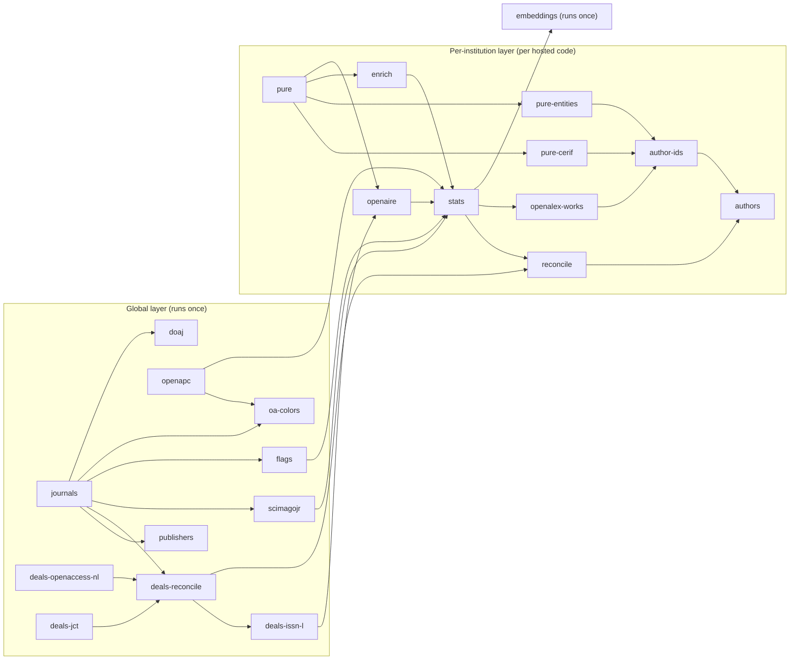

# Bootstrap DAG

Active contributors: utsmok

## Purpose

`backend/jobs/bootstrap.py` is the initial-deployment pipeline: every harvest job wired as a
dependency DAG, run by one command. Docker Compose boots it once per `up` through the
one-shot `bootstrap` service. Each step execs an idempotent standalone job from
`backend/jobs/`; independent steps run concurrently while a failed step stops new launches
and is named in the output.

The graph has two layers plus a capstone:

- **Global layer** (`GLOBAL_STEPS` in `backend/jobs/bootstrap.py`): the shared core, run once.
- **Per-institution layer** (`INST_STEPS`): the Pure/enrich/stats/author chain, run once per
  hosted institution code. Step names are qualified as `step:code` (for example
  `pure-cerif:ut`).
- **Embeddings**: institution-neutral, runs once after every institution's stats step.

The list order is a topological order and doubles as the `--from` resume order.

## Directory layout

| Path | Role |
|---|---|
| `backend/jobs/bootstrap.py` | The DAG runner: step tables, dependency maps, planners, runners. |
| `backend/jobs/*.py` | The individual jobs each step execs; one CLI per file. |
| `docker-compose.yml` | The `bootstrap` service and the backend gating on its success. |
| `backend/src/journal_browser/config.py` | The `bootstrap` setting behind `JB_BOOTSTRAP`. |

## Key abstractions

| Abstraction | Where | Role |
|---|---|---|
| `GLOBAL_STEPS` / `GLOBAL_DEPS` | `backend/jobs/bootstrap.py` | Global step list and dependency map. |
| `INST_STEPS` / `INST_DEPS` | `backend/jobs/bootstrap.py` | Per-institution chain; deps reference global steps or same-code steps. |
| `EMBEDDINGS_STEP` | `backend/jobs/bootstrap.py` | `embed_journals.py`, depending on every per-institution `stats` step. |
| `hosted_codes()` | `backend/jobs/bootstrap.py` | Active institution codes via `get_active_institutions`. |
| `already_bootstrapped()` | `backend/jobs/bootstrap.py` | Counts `journals` rows; drives the auto-mode skip. |
| `build_plan()` | `backend/jobs/bootstrap.py` | Assembles (steps, deps) for the run; `--institution` drops the global layer and embeddings. |
| `run_parallel()` / `run_serial()` | `backend/jobs/bootstrap.py` | Concurrent scheduler by default; serial mode for `--from` repairs. |
| `normalize_from()` | `backend/jobs/bootstrap.py` | Resolves a bare step name to its qualified plan entry, failing loudly. |
| `run_harvest()` | `backend/src/journal_browser/harvest/common.py` | Per-run bookkeeping inside each job (see [Data pipeline](index.md)). |

## How it works

### Steps and dependencies

Global layer, in resume order: `journals`, `publishers`, `deals-openaccess-nl`,
`deals-jct`, `openapc`, `deals-reconcile`, `deals-issn-l`, `scimagojr`, `flags`,
`oa-colors`, `doaj`. Notable dependencies: publisher lineage needs journal names; deal
reconcile needs both deal sources plus the journal universe; ISSN-L backfill needs
reconciled deals; the OA-color sampler needs journals plus OpenAPC aggregates; the DOAJ
sweep needs the journal sweep to have stamped OA candidates.

Per-institution chain, in resume order: `pure` (works sweep with `--full-sweep`),
`pure-cerif` (CERIF pass of the same job), `pure-entities`, `enrich`, `openaire`, `stats`,
`reconcile`, `openalex-works`, `author-ids`, `authors`. The `pure-cerif` and
`pure-entities` steps depend only on `pure`, and `enrich` and `openaire` can run beside
each other; the CERIF pass is sequenced after the works sweep anyway so the OAI endpoint
sees one heavy client at a time. Cross-layer dependencies tie the layers together:
`openaire` waits for `deals-issn-l`, `stats` waits for `openapc`, `scimagojr`, and `flags`,
and the per-institution `reconcile` waits for the global `deals-reconcile`.

### Planning and running

`build_plan()` copies the global tables, then expands `INST_STEPS` once per hosted code,
qualifying names and rewriting dependencies (`pure:ut` depends on `pure`; `openaire:ut`
depends on `deals-issn-l`). With `--institution CODE` the plan keeps only that code's
steps and drops global dependencies, whose outputs already exist in the database.

`run_parallel()` launches every step whose dependencies have succeeded, as subprocesses via
`asyncio.create_subprocess_exec`, and waits on `FIRST_COMPLETED`. A failed step stops all
new launches; running steps finish; at the end the runner prints
`bootstrap: FAILED steps: ...` and exits 1. `run_serial()` backs the `--from` repair path:
it walks the list in order starting at the resolved step, ignoring the dependency map.

### Modes and flags

- Mode comes from `--always`, else the `bootstrap` setting (`JB_BOOTSTRAP`, default `auto`).
- `auto` with no other flags and journals already present prints
  `journals present, nothing to do` and exits 0.
- `off` exits early unless `--institution` names a layer to run.
- `--from STEP` accepts the bare step name when it resolves to exactly one plan entry
  (`pure-cerif` becomes `pure-cerif:ut` on a single-institution deployment); ambiguity or
  no match exits with code 2 and a message that names the qualified form.
- `--institution CODE` validates against `hosted_codes()`; an unknown or inactive code
  exits with code 2.

### How Compose runs it

The `bootstrap` service in `docker-compose.yml` runs
`sh -c "uv run --no-dev alembic upgrade head && uv run --no-dev python jobs/bootstrap.py"`
with `restart: "no"`. It starts once the database is healthy; the backend starts only after
the service completes successfully. A fresh host's landing mount is created root-owned, so
the service starts as root and the entrypoint hands the directory to uid 1000 before
dropping privileges. Because `auto` mode exits in seconds on a bootstrapped database,
routine `docker compose up` invocations pay almost nothing for this service.

### Failure behavior

Steps are subprocesses, so a crash stays contained: the step logs name the job, the runner
names the step, the process exits 1, and Compose reports the bootstrap service as failed.
The database keeps every per-page commit that landed before the failure, and the backend
never starts. Repair is `--from <failed step>` (optionally scoped with `--institution`),
or `--always` to redo everything.

## Integration points

- `docker-compose.yml`: service wiring, `JB_BOOTSTRAP`, and the backend gate.
- `backend/src/journal_browser/config.py`: the `bootstrap` setting and `landing_dir`.
- `backend/src/journal_browser/harvest/common.py`: institution discovery
  (`get_active_institutions`, `resolve_institution`) used by `hosted_codes()` and by every
  job's `--institution` flag.
- The admin runs pages (`backend/src/journal_browser/routers/admin/runs.py`) inspect the
  `harvest_runs` rows each step writes.
- [Harvest sources](harvest-sources.md) documents what each step actually fetches.

## Entry points for modification

- Add or reorder a step: edit `GLOBAL_STEPS`/`GLOBAL_DEPS` or `INST_STEPS`/`INST_DEPS` in
  `backend/jobs/bootstrap.py` and keep the list a topological order, since it is also the
  resume order.
- Onboard an institution: insert the `institutions` row (env seeds the home institution;
  see `ensure_home_institution` in `backend/src/journal_browser/harvest/common.py`), then
  run `backend/jobs/bootstrap.py --institution CODE`.
- Change what a step does: edit the job CLI in `backend/jobs/` and its adapter under
  `backend/src/journal_browser/harvest/`; keep the job idempotent.

## Key source files

| File | Role |
|---|---|
| `backend/jobs/bootstrap.py` | The DAG runner and the subject of this page. |
| `backend/jobs/harvest_journals.py` | Global `journals` step: OpenAlex sources sweep. |
| `backend/jobs/harvest_pure.py` | `pure` and `pure-cerif` steps (same CLI, different flags). |
| `backend/jobs/enrich_works.py` | `enrich` step: OpenAlex, Crossref, CERIF ladder. |
| `backend/jobs/reconcile.py` | Global deal merge and per-institution participation. |
| `backend/jobs/ingest_authors.py` | Final `authors` step via the source adapter. |
| `backend/jobs/embed_journals.py` | The `embeddings` capstone. |
| `docker-compose.yml` | Bootstrap service command and backend gating. |

## Related pages

- [Data pipeline](index.md) for the landing zone, bookkeeping, and repair workflow.
- [Data model](../data-model.md) for the tables each step writes.
- [Design decisions](../../background/design-decisions.md) for why the pipeline boots as a
  one-shot service.
- [Architecture](../../overview/architecture.md) for where the bootstrap container sits in
  the deployment.
